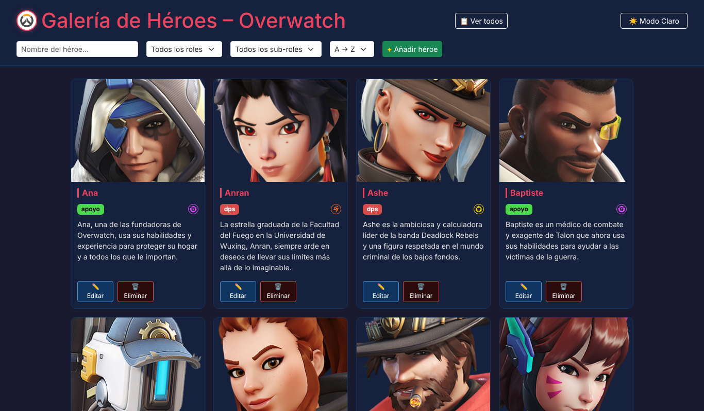
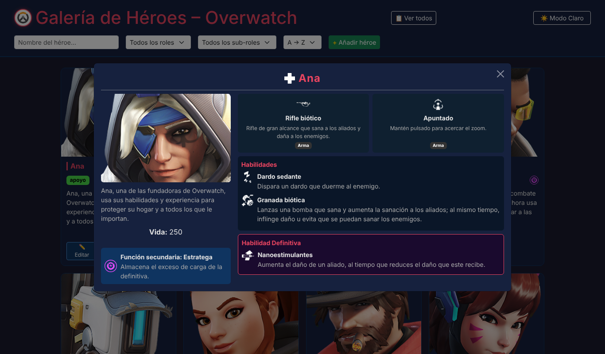
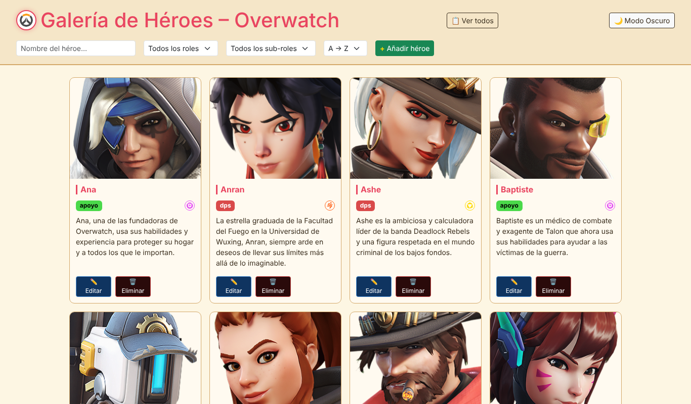
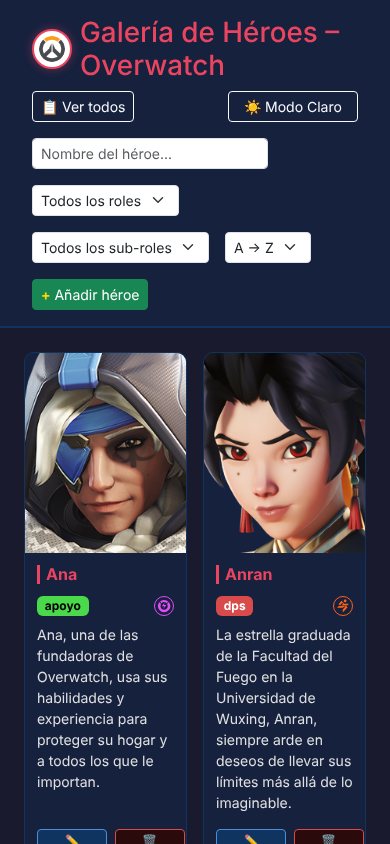

# 🦸 Galería de Héroes de Overwatch

Aplicación web para explorar, buscar y gestionar los héroes de **Overwatch**: su función, sus habilidades, su definitiva y sus pasivas.

Proyecto final de **1º de DAM** que junta las asignaturas de **Lenguaje de Marcas** y **Programación**: un frontend con HTML, CSS, JavaScript y Bootstrap que habla con una API REST hecha en **Spring Boot**, con los datos guardados en **PostgreSQL**.

<p>
  
  
  
  
  
</p>



## ✨ Qué hace

- 🗂️ **51 héroes** (14 tanques, 23 de daño y 14 de apoyo), cada uno con su descripción, vida, función secundaria y todas sus habilidades.
- 🔍 **Buscador y filtros** por nombre, rol y sub-rol, y orden alfabético.
- 🪟 **Ficha detallada** de cada héroe: armas, habilidades, definitiva y pasivas.
- ✏️ **CRUD completo**: añadir, editar y eliminar héroes desde la propia web.
- 🌗 **Modo claro y oscuro**.
- 📱 **Diseño adaptable** a móvil.
- 💾 Al arrancar por primera vez, la base de datos se rellena sola con todos los héroes.

## 📸 Capturas

| Pantalla de inicio | Ficha de un héroe |
|---|---|
|  |  |

| Modo claro | Móvil |
|---|---|
|  |  |

## 🏗️ Cómo está hecho

```
src/main/java/dam/code/galeria_overwatch
├── controller/   → API REST (/heroes)
├── service/      → lógica de negocio
├── repository/   → acceso a datos con Spring Data JPA
└── model/        → entidades Heroe y Habilidad (relación 1:N)

src/main/resources/static
├── inicio.html   → pantalla de bienvenida
├── index.html    → galería
├── script.js     → consumo de la API, filtros, modales y CRUD
└── style.css     → estilos y modo claro/oscuro
```

### API REST

| Método | Ruta | Descripción |
|---|---|---|
| `GET` | `/heroes` | Lista todos los héroes |
| `GET` | `/heroes/{id}` | Devuelve un héroe |
| `POST` | `/heroes` | Crea un héroe |
| `PUT` | `/heroes/{id}` | Edita un héroe |
| `DELETE` | `/heroes/{id}` | Elimina un héroe |

## 🚀 Cómo ejecutarlo

**Requisitos:** Java 21 y PostgreSQL.

1. Crea la base de datos:
   ```sql
   CREATE DATABASE galeria_overwatch;
   ```
2. Indica tu usuario y contraseña de PostgreSQL con variables de entorno (si no las pones, usa `postgres` / `postgresql`):
   ```bash
   # Linux / macOS
   export DB_USER=postgres
   export DB_PASSWORD=tu_contraseña

   # Windows (PowerShell)
   $env:DB_USER="postgres"
   $env:DB_PASSWORD="tu_contraseña"
   ```
3. Arranca la aplicación:
   ```bash
   ./mvnw spring-boot:run
   ```
4. Abre **http://localhost:8080/inicio.html** 🎮

## ⚖️ Aviso

Proyecto de fans, hecho con fines educativos y sin ánimo de lucro. **Overwatch**, sus personajes, nombres e imágenes son propiedad de **Blizzard Entertainment, Inc.** Este proyecto no está afiliado ni respaldado por Blizzard.

---

Hecho por [Sergio Navarro (Colt246)](https://github.com/Colt246) · 1º DAM · Prometeo by ThePower
